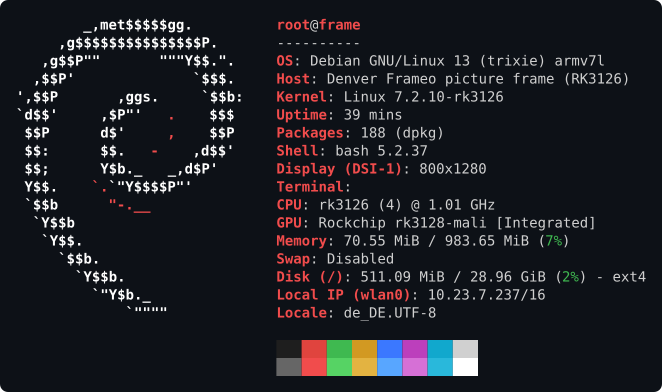
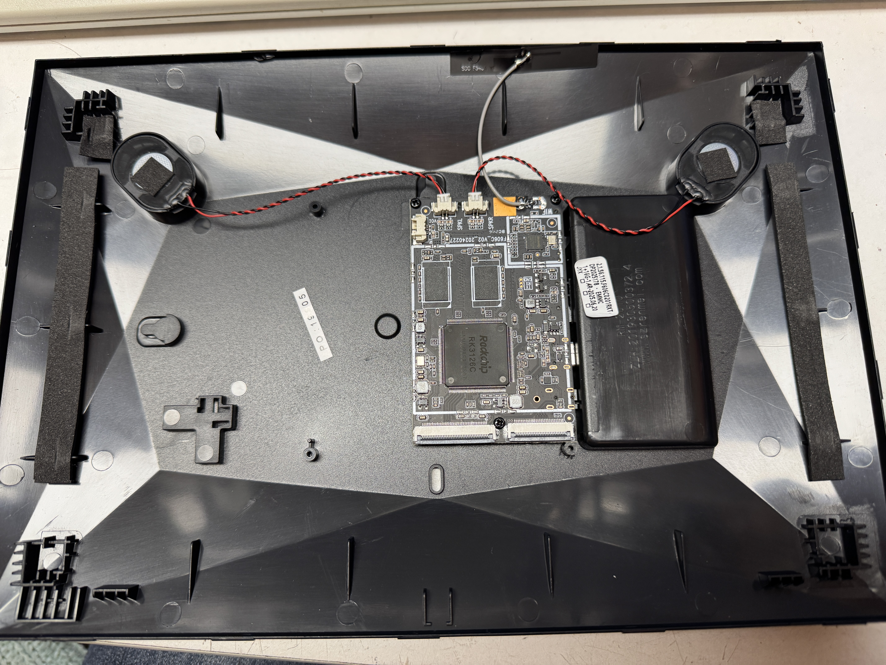
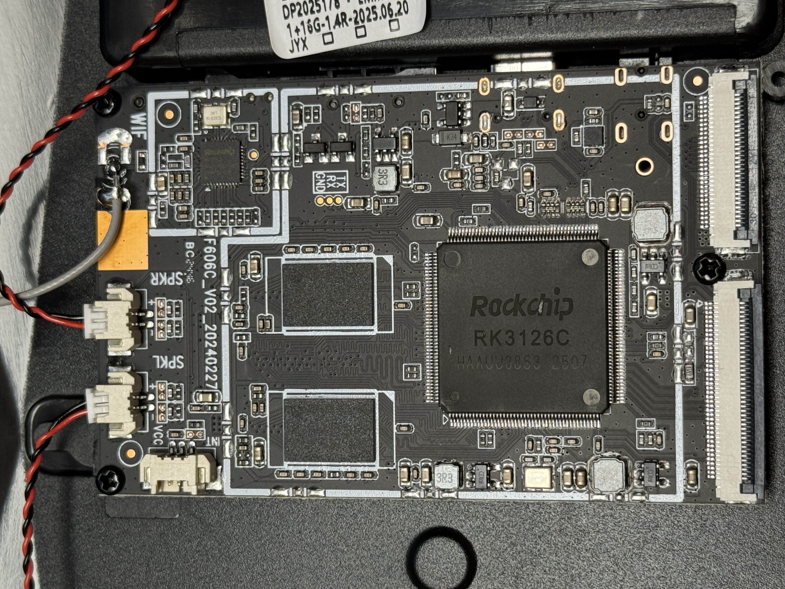
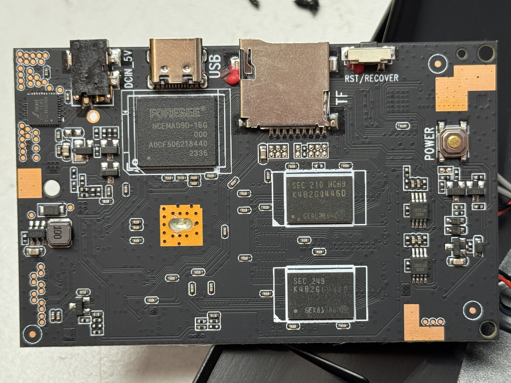
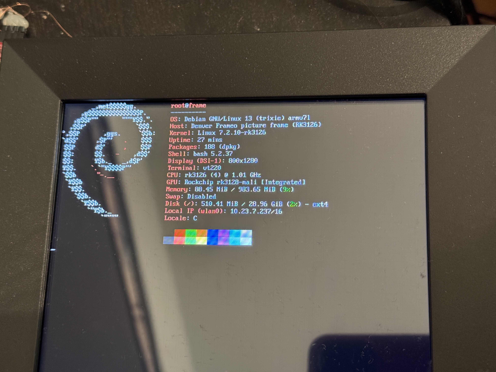
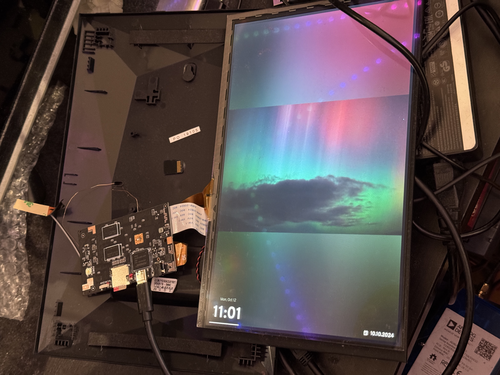

# Debian for the Denver Frameo picture frame (RK3126B)

> [!CAUTION]
> 🦠 The stock Android firmware shipping with these devices seems to be infected with some sort of adware/malware ("Adups FOTA"), which contacts various unknown servers.
> Don't let these devices onto your network with stock firmware:  
> https://www.heise.de/news/Adups-China-Billighandys-spionieren-ihre-Nutzer-ab-Werk-aus-3486446.html

> [!WARNING]
> 🤖☢️ Vibe-coded software!
> This repo was written in large parts by Claude Code and it does not meet my
> usual quality & care standards. It probably has bugs and I take no responsibility
> if it behaves badly or even hurts your computer in any way.
> Treat this project with the appropriate caution.

Clean, mainline Debian Linux image (similar to Raspberry Pi OS) for the Denver Frameo picture frame  
("F606C" board, Rockchip RK3126B, 800x1280 MIPI DSI panel, GSL3673 touch, RK915 WiFi)



# Features

- Debian 13 (trixie), 32-bit armv7l/armhf, 4 CPU cores
- LCD panel support (800x1280 MIPI DSI)
- 3D acceleration (Mali GPU, OpenGL ES 2.0)
- Touchscreen support
- X11 and Wayland support
- WiFi (RK915, 2.4GHz only, ~25 MBit/s throughput)
- Dynamic frequency scaling (idle support, reduces power consumption)
- USB peripheral mode, USB host mode (switched by hand, experimental)
- MicroSD and eMMC support
- Hardware video decoding (Hantro VPU: H.264 up to 1080p at ~30 fps, VP8, MPEG-2) through the V4L2 stateless decoder API, e.g. GStreamer `v4l2slh264dec` (not installed by default, not used by Chromium)

# Performance

SD card performance is severely limited (~2 MByte/s) because the SD card shares some pins with the UART serial interface.
This causes the SD card to only run in 1-bit mode.

Internal eMMC can reach about 60 MByte/s reading and 50 MByte/s writing (DDR52 mode).

The CPU and GPU performance is comparable to a Raspberry Pi 2.

# How to install

- Download the [latest release](https://github.com/Manawyrm/denver-frameo-rk3126-debian/releases) from the GitHub releases tab and flash it onto a microSD card using a tool like BalenaEtcher, Win32DiskImager or dd. Remember to extract the .xz archive.
- Replug the SD card (or run partprobe on Linux)
- Mount the FAT32 partition
- (optional) add your SSH keys as a file called `authorized_keys`
- (optional) add your WiFi credentials as a file called `wpa_supplicant.conf` (using standard syntax)

# Login via SSH

The frame offers a SSH server on port 22, username `root`, password `root`.  
If you provided an `authorized_keys` file, this will be available as well.

# Login via USB serial console

Run `screen /dev/ttyACM0 115200` on a computer connected to the USB-C port of the picture frame.

# USB device mode features

> [!WARNING]
> **Bad USB-C implementation:** The hardware design seems to be severely flawed.  
> The USB-C CC resistors are missing, so some devices (like MacBooks) will never try to talk to the picture frame.
> Use a USB-C -> USB-A and USB-A -> USB-C adapter or cable chain.
>
> **Orientation matters!** Because they also messed up the D+/D- data lines communication might only work with the USB-C plug in one direction.
> If you're having trouble enumerating the USB device, flip the USB-C plug (on the tablet side!).
>
> **Bad signal integrity** USB 2.0/480 MBit/s wasn't reliable against my Apple Silicon Mac, but worked against a Intel 10th Gen platform.
> Try another computer or downgrade the tablet to USB 1.1/12MBit/s if you're having issues.

The picture frame has full USB peripheral support and will expose itself as a USB serial port and a USB Ethernet adapter:

```
[2573972.880197] usb 1-3: new high-speed USB device number 98 using xhci_hcd
[2573973.037063] usb 1-3: New USB device found, idVendor=1d6b, idProduct=0104, bcdDevice= 1.00
[2573973.039427] usb 1-3: New USB device strings: Mfr=1, Product=2, SerialNumber=3
[2573973.041798] usb 1-3: Product: RK3126 picture frame (Debian)
[2573973.044078] usb 1-3: Manufacturer: Denver Frameo
[2573973.046420] usb 1-3: SerialNumber: 0x5d7946c1
[2573973.051689] cdc_acm 1-3:1.0: ttyACM0: USB ACM device
[2573973.055169] cdc_ether 1-3:1.2 usb0: register 'cdc_ether' at usb-0000:00:14.0-3, CDC Ethernet Device, 02:52:4b:31:32:37
[2573973.617019] cdc_ether 1-3:1.2 enx02524b313237: renamed from usb0
```

# USB host mode (experimental)

The USB-C port starts in device mode (serial console and Ethernet, see above).
It can be switched to host mode by hand, and back:

```
echo host > /sys/class/usb_role/10180000.usb-role-switch/role
echo device > /sys/class/usb_role/10180000.usb-role-switch/role
```

The frame cannot supply power to the attached device: VBUS of the USB-C port is only its power input.
The device needs 5V from the same power supply as the frame, e.g. through an OTG Y-cable with a power input,
or a USB hub fed by the same supply.
The warnings about the USB-C port above (orientation, signal integrity) apply in host mode as well.

# Possible future improvements (not yet supported)

- Audio support
- USB host mode tested with real devices (e.g. wired Ethernet, storage, keyboard/mice, etc.) -- would pair well with a cheap USB-C PoE adapter!

# Internals/PCBs






